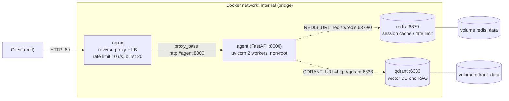

# Day 14 — Mission Answers

## Part 1 — Localhost vs Production

### Exercise 1.1: Anti-pattern trong `01-localhost-vs-production/develop/app.py`

| # | Anti-pattern | Dòng | Hậu quả |
|---|---|---|---|
| 1 | Hardcode secret: `OPENAI_API_KEY = "sk-..."` và `DATABASE_URL` có cả user/password | 17–18 | Push lên GitHub là lộ key và mật khẩu DB. Đổi key phải sửa code và deploy lại. |
| 2 | In secret ra log: `print(f"[DEBUG] Using key: {OPENAI_API_KEY}")` | 34 | Ai đọc được log (log aggregator, đồng nghiệp, CI) đều thấy key. Đã kiểm chứng: log server in ra `Using key: sk-hardcoded-fake-key-never-do-this`. |
| 3 | Config cứng trong code: `DEBUG = True`, `MAX_TOKENS = 500` | 21–22 | Không đổi được giữa dev/staging/prod mà không sửa code (vi phạm 12-Factor: Config). |
| 4 | Dùng `print()` thay vì logging có cấu trúc, in cả nội dung câu hỏi và câu trả lời | 33, 38 | Không có level, không có timestamp, không parse được bằng Loki/Datadog; còn log cả dữ liệu người dùng. |
| 5 | Không có `/health`, `/ready` | 42–43 | Platform không biết agent còn sống hay đã sẵn sàng nên không tự restart, load balancer không biết lúc nào nên ngừng gửi traffic. Đã kiểm chứng: `GET /health` trả 404. |
| 6 | `host="localhost"` | 51 | Chỉ nhận kết nối từ trong máy. Chạy trong container thì bên ngoài không gọi vào được. |
| 7 | `port=8000` cố định | 52 | Railway/Render cấp port qua biến `PORT`; app không đọc nên không nhận được traffic. |
| 8 | `reload=True` | 53 | Chế độ dev: chạy thêm process theo dõi file, tốn tài nguyên, có thể tự restart giữa chừng trong production. |
| 9 | Không xử lý shutdown (không lifespan, không bắt SIGTERM) | — | Khi platform tắt/deploy lại, request đang chạy bị cắt ngang, không có chỗ đóng kết nối DB. |

### Exercise 1.2: Chạy bản develop

Bản develop nhận `question` qua query string:

```text
$ curl -i -X POST "http://localhost:8000/ask?question=Hello"
HTTP/1.1 200 OK
content-type: application/json

{"answer":"Agent đang hoạt động tốt! (mock response) Hỏi thêm câu hỏi đi nhé."}
```

Gửi JSON body như trong `CODE_LAB.md` thì bị 422, vì FastAPI đọc `question: str` là query param:

```text
$ curl -i -X POST http://localhost:8000/ask -H "Content-Type: application/json" -d '{"question":"Hello"}'
HTTP/1.1 422 Unprocessable Entity

{"detail":[{"type":"missing","loc":["query","question"],"msg":"Field required","input":null}]}
```

Log phía server (thấy rõ secret bị in ra):

```text
INFO:     Uvicorn running on http://localhost:8000 (Press CTRL+C to quit)
INFO:     Started reloader process [5711] using WatchFiles
[DEBUG] Got question: Hello
[DEBUG] Using key: sk-hardcoded-fake-key-never-do-this
[DEBUG] Response: Agent đang hoạt động tốt! (mock response) Hỏi thêm câu hỏi đi nhé.
```

**Nhận xét:** app chạy được, nhưng chưa production-ready: lộ secret trong code và log, chỉ bind `localhost`, không có health check (`/health` → 404), chạy với reloader.

### Exercise 1.3: So sánh develop và production

Kết quả chạy bản production (`cp .env.example .env`, rồi `python app.py`):

```text
$ curl http://localhost:8000/health
{"status":"ok","uptime_seconds":0.2,"version":"1.0.0","environment":"development","timestamp":"2026-11-26T08:12:35.186319+00:00"}
$ curl http://localhost:8000/ready
{"ready":true}
$ curl -X POST http://localhost:8000/ask -H "Content-Type: application/json" -d '{"question":"Hello"}'
{"question":"Hello","answer":"Tôi là AI agent được deploy lên cloud. Câu hỏi của bạn đã được nhận.","model":"gpt-4o-mini"}
$ curl -i -X POST http://localhost:8000/ask -H "Content-Type: application/json" -d '{}'
HTTP/1.1 422 Unprocessable Entity
```

Gửi SIGTERM (`kill -TERM <pid>`), server tắt có trình tự, exit code 0:

```text
INFO:     Shutting down
INFO:     Waiting for application shutdown.
INFO:     Application shutdown complete.
INFO:     Finished server process [5812]
```

| Feature | Basic (develop) | Advanced (production) | Tại sao quan trọng? |
|---|---|---|---|
| Config | Hardcode trong code (`OPENAI_API_KEY`, `DEBUG`, port) | Đọc từ env vars qua `config.py` (`Settings`), có `validate()` báo lỗi nếu thiếu `AGENT_API_KEY` khi `ENVIRONMENT=production` | Không có secret trong Git; cùng một image chạy được ở dev/staging/prod chỉ bằng cách đổi env; thiếu config quan trọng thì dừng ngay lúc khởi động thay vì lỗi lúc đang phục vụ. |
| Secret trong log | In thẳng API key ra stdout | Chỉ log `question_length`, `response_length`, `client_ip`, không log secret hay nội dung | Log thường được gửi sang nhiều hệ thống và nhiều người đọc được; secret trong log coi như đã lộ. |
| Health check | Không có (`/health` → 404) | `/health` (liveness, có uptime/version) và `/ready` (readiness, trả 503 khi chưa sẵn sàng) | Platform dùng `/health` để tự restart container chết; load balancer dùng `/ready` để chỉ gửi traffic vào instance đã sẵn sàng. |
| Logging | `print()` không level, không timestamp | `logging` với format JSON (`time`, `level`, `msg`) | Log aggregator (Loki, Datadog) parse và lọc theo field được; có level để tắt bớt DEBUG ở production. |
| Shutdown | Đột ngột, không có hook | `lifespan` đặt `is_ready=False` rồi dọn dẹp; có đăng ký handler SIGTERM | Khi deploy lại hoặc scale down, request đang xử lý được làm xong, kết nối được đóng đúng cách, không trả lỗi cho người dùng. |
| Host / Port | `localhost:8000` cố định | `HOST` (mặc định `0.0.0.0`) và `PORT` từ env | Container và cloud cần bind `0.0.0.0` và dùng port platform cấp. |
| Reload / Debug | `reload=True` luôn bật | `reload=settings.debug`, mặc định `DEBUG=false` | Không chạy reloader trong production. |
| Input | Query param, không validate | JSON body, câu hỏi rỗng trả 422 | API rõ ràng hơn, từ chối input sai sớm. |
| CORS | Không cấu hình | `ALLOWED_ORIGINS` từ env | Chỉ frontend được phép mới gọi được từ trình duyệt. |

**Quan sát thêm khi chạy thật:**

- Các dòng log JSON của app (`startup`, `agent_request`) không xuất hiện trong output. Lý do là thứ tự import: `app.py` import `config` trước, và `Settings().validate()` gọi `logging.warning(...)` (dòng log `WARNING:root:OPENAI_API_KEY not set` ở đầu output). Lệnh này tự gắn handler mặc định cho root logger với level `WARNING`, nên `logging.basicConfig(...)` trong `app.py` chạy sau không còn tác dụng: format JSON không được áp dụng và mọi log `INFO` bị bỏ. Kiểm chứng sau khi import `app`: root level = `WARNING`, format = `%(levelname)s:%(name)s:%(message)s`. Cách sửa: gọi `basicConfig(..., force=True)` hoặc cấu hình logging trước khi import `config`.
- Dòng `Received SIGTERM` của `handle_sigterm` cũng không in ra, vì uvicorn đăng ký signal handler của chính nó khi chạy, đè lên handler này. Graceful shutdown vẫn xảy ra nhờ uvicorn + `lifespan`.
- `config.py` không gọi `load_dotenv()`, nên file `.env` không tự được nạp; app chạy được là nhờ giá trị mặc định. Muốn dùng `.env` thì phải `export` biến hoặc thêm `load_dotenv()`.

### Checkpoint 1

- **Vì sao hardcode secret nguy hiểm:** code được push lên Git, lịch sử commit giữ mãi; ai có quyền đọc repo (hoặc repo public) đều lấy được key. Muốn xoay key phải sửa code và deploy lại.
- **Dùng environment variables:** đọc qua `os.getenv("TÊN", "mặc định")`, gom vào một chỗ (`config.py`), đặt giá trị bằng `.env` (không commit) ở local hoặc trong phần Variables của platform khi deploy.
- **Vai trò health check:** `/health` trả lời "process còn sống không" để platform restart khi chết; `/ready` trả lời "có nhận request được chưa" để load balancer quyết định gửi traffic.
- **Graceful shutdown:** khi nhận SIGTERM, app ngừng nhận request mới, làm nốt request đang chạy, đóng kết nối rồi mới thoát.

---

## Part 2 — Docker

### Exercise 2.1: Đọc `02-docker/develop/Dockerfile`

1. **Base image:** `python:3.11`, bản Python đầy đủ trên Debian (có sẵn gcc, git, header build...), nên rất nặng.
2. **Working directory:** `/app` (`WORKDIR /app`). Các lệnh `COPY`, `RUN`, `CMD` sau đó đều chạy tương đối với thư mục này.
3. **Vì sao `COPY requirements.txt` trước `COPY app.py`:** Docker cache theo từng layer, một layer thay đổi thì mọi layer sau nó phải build lại. `requirements.txt` ít đổi, code đổi liên tục. Copy requirements và `pip install` trước thì khi chỉ sửa code, layer cài thư viện vẫn lấy từ cache, build lại mất vài giây thay vì cài lại toàn bộ. Nếu `COPY . .` trước, mỗi lần sửa một dòng code đều phải chạy lại `pip install`.
4. **CMD và ENTRYPOINT:** `ENTRYPOINT` là chương trình cố định của container; tham số ở `docker run <image> <args>` được nối thêm vào sau nó. `CMD` là lệnh hoặc tham số mặc định, bị thay thế hoàn toàn nếu `docker run` truyền lệnh khác. File này chỉ dùng `CMD ["python", "app.py"]`, nên `docker run my-agent:develop bash` sẽ mở shell thay vì chạy app. Khi dùng cả hai, `CMD` trở thành tham số mặc định cho `ENTRYPOINT`.

### Exercise 2.2: Build và chạy bản develop

```text
$ docker build -f 02-docker/develop/Dockerfile -t my-agent:develop .     # build từ gốc repo
$ docker run -d --name cp2-dev -p 8000:8000 my-agent:develop

$ curl -i -X POST "http://localhost:8000/ask?question=What%20is%20Docker%3F"
HTTP/1.1 200 OK
{"answer":"Container là cách đóng gói app để chạy ở mọi nơi. Build once, run anywhere!"}

$ curl http://localhost:8000/health
{"status":"ok","uptime_seconds":0.4,"container":true}

$ docker exec cp2-dev whoami
root
```

App develop của Part 2 vẫn nhận `question` qua query string (gửi JSON sẽ bị 422). Container chạy bằng `root`.

### Exercise 2.3: Multi-stage build (`02-docker/production/Dockerfile`)

- **Stage 1 (`builder`, `python:3.11-slim`):** cài `gcc`, `libpq-dev`, rồi `pip install --user -r requirements.txt` vào `/root/.local`. Stage này chỉ dùng để build, không được ship.
- **Stage 2 (`runtime`, `python:3.11-slim`):** tạo user `appuser`, chỉ `COPY --from=builder /root/.local` (thư viện đã cài) cùng `main.py` và `utils/mock_llm.py`, chuyển sang `USER appuser`, khai báo `HEALTHCHECK`, chạy `uvicorn` với 2 worker.
- **Vì sao nhỏ hơn:** (1) base `slim` thay vì bản đầy đủ; (2) gcc, header, apt cache và pip cache nằm lại ở stage builder, image cuối không chứa chúng; (3) chỉ copy đúng file cần chạy. Theo `docker history`, layer thư viện copy sang chỉ nặng 40.8 MB, phần còn lại là base slim.

Build và đo (số đo trên máy, `docker images`):

```text
$ docker build -f 02-docker/production/Dockerfile -t my-agent:advanced .
$ docker images
IMAGE                              ID             DISK USAGE   CONTENT SIZE   EXTRA
my-agent:advanced                  f9be8e8a1602        240MB         57.4MB
my-agent:develop                   db5d04e5afe9       1.67GB          426MB
```

| Image | Disk usage | Content size (nén) |
|---|---|---|
| `my-agent:develop` | 1.67 GB (~1670 MB) | 426 MB |
| `my-agent:advanced` | 240 MB | 57.4 MB |
| **Giảm** | **~85.6%** ((1670 − 240) / 1670) | **~86.5%** ((426.3 − 57.4) / 426.3) |

Kiểm tra bản advanced khi chạy:

```text
$ curl -i -X POST http://localhost:8000/ask -H "Content-Type: application/json" -d '{"question":"What is Docker?"}'
HTTP/1.1 200 OK
{"answer":"Container là cách đóng gói app để chạy ở mọi nơi. Build once, run anywhere!"}

$ docker exec cp2-adv whoami
appuser

$ docker ps
cp2-adv   Up 7 seconds (healthy)
```

Ngoài nhỏ hơn, image advanced còn chạy bằng non-root user và có `HEALTHCHECK` (trạng thái `healthy` trong `docker ps`).

### Exercise 2.4: Docker Compose stack

Chạy với tên project riêng để không trùng với các thư mục `production` khác:

```bash
cd 02-docker/production
docker compose -p k5-day14-docker up -d --build
```

Có 4 service được start, theo thứ tự `depends_on`: `redis` và `qdrant` trước; chờ cả hai `healthy` rồi mới tới `agent`; cuối cùng là `nginx`.

```text
SERVICE   IMAGE                   STATUS                    PORTS
agent     k5-day14-docker-agent   Up (healthy)              8000/tcp
nginx     nginx:alpine            Up                        0.0.0.0:80->80/tcp, 0.0.0.0:443->443/tcp
qdrant    qdrant/qdrant:v1.9.0    Up (healthy)              6333-6334/tcp
redis     redis:7-alpine          Up (healthy)              6379/tcp
```

**Sơ đồ kiến trúc:**



**Các service giao tiếp thế nào:**

- Cả 4 service nằm chung network bridge `internal`. Docker có DNS nội bộ nên gọi nhau bằng tên service. Kiểm chứng từ trong container agent: `redis → 172.21.0.3`, `qdrant → 172.21.0.2`, `nginx → 172.21.0.5`.
- Chỉ `nginx` mở port ra máy host (80, 443). `agent` chỉ `expose` 8000 trong network: gọi thẳng `curl http://localhost:8000/health` từ host bị từ chối kết nối. Mọi traffic phải đi qua Nginx.
- Nginx chuyển tiếp tới `upstream agent_backend` (`server agent:8000`) và thêm header `X-Real-IP`, `X-Forwarded-For`.
- Agent nhận địa chỉ Redis/Qdrant qua biến môi trường. Lưu ý: `main.py` của bài này chưa thực sự kết nối Redis hay Qdrant; hai service này đang chuẩn bị sẵn cho các phần sau.

**Test qua Nginx:**

```text
$ curl -i http://localhost/health
HTTP/1.1 200 OK
X-Frame-Options: DENY
X-Content-Type-Options: nosniff
X-XSS-Protection: 1; mode=block
{"status":"ok","uptime_seconds":7.8,"version":"2.0.0","timestamp":"2026-11-26T08:26:19.536475"}

$ curl -i -X POST http://localhost/ask -H "Content-Type: application/json" -d '{"question":"Explain microservices"}'
HTTP/1.1 200 OK
Server: nginx
X-Frame-Options: DENY
{"answer":"Đây là câu trả lời từ AI agent (mock). Trong production, đây sẽ là response từ OpenAI/Anthropic."}
```

Header `Server: nginx` và các security header (`X-Frame-Options`...) cho thấy response đi qua Nginx. Gửi 40 request song song vào `/ask`:

```text
     21 200
     19 429
```

Đúng với cấu hình `rate=10r/s burst=20 nodelay`: 1 request trong rate cộng 20 request burst thì qua, phần còn lại bị Nginx trả 429.

Tắt stack: `docker compose -p k5-day14-docker down`.

### Checkpoint 2

- **Cấu trúc Dockerfile:** `FROM` (base) → `WORKDIR` → `COPY` requirements → `RUN pip install` → `COPY` code → `EXPOSE` → `CMD`. Thứ tự từ ít thay đổi đến hay thay đổi để tận dụng cache.
- **Lợi ích multi-stage:** image nhỏ hơn khoảng 86% (đo được ở trên), không mang theo compiler và build tool (ít lỗ hổng hơn), pull và deploy nhanh hơn.
- **Docker Compose:** khai báo nhiều service, network, volume trong một file; `depends_on` kèm `condition: service_healthy` điều khiển thứ tự khởi động; một lệnh `up`/`down` cho cả stack.
- **Debug container:** `docker logs <container>` (hoặc `docker compose -p <project> logs <service>`) để xem stdout/stderr; `docker exec -it <container> sh` để vào trong kiểm tra (bài này dùng `docker exec ... whoami` và kiểm tra DNS từ trong container agent); `docker ps` để xem trạng thái health.

---

## Part 3 — Cloud Deployment

### Exercise 3.1: Deploy Railway (agent Part 6)

- **URL public:** https://agent-production-09013268.up.railway.app
- Chi tiết lệnh, biến môi trường và kết quả: [DEPLOYMENT.md](DEPLOYMENT.md).

Các bước đã làm (trong `06-lab-complete/`):

```bash
railway login --browserless
railway init --name k5-day14-agent
railway add --database redis
railway add --service agent --variables "ENVIRONMENT=production" \
  --variables 'REDIS_URL=${{Redis.REDIS_URL}}' \
  --variables "RATE_LIMIT_PER_MINUTE=10" --variables "DAILY_BUDGET_USD=1.0"
python -c "import secrets;print(secrets.token_urlsafe(32), end='')" | railway variable set AGENT_API_KEY --stdin --service agent
railway up --service agent --ci
railway domain --service agent
```

Kết quả 4 lệnh tự kiểm tra của CP6:

```text
health: 200
ready:  200
ask không key: 401
ask có key:    200
```

Log khởi động trên Railway (dòng của app là JSON; Railway tự cấp `PORT=8080`):

```text
INFO:     Started server process [460]
{"ts": "2026-11-26T09:25:34.494+00:00", "lvl": "INFO", "logger": "app", "event": "startup", "environment": "production", "version": "1.0.0", "rate_limit_per_minute": 10, "daily_budget_usd": 1.0, "api_key_configured": true}
INFO:     Uvicorn running on http://0.0.0.0:8080 (Press CTRL+C to quit)
```

(Railway hiển thị dòng JSON dưới dạng `key=value` trong giao diện log vì nó tự parse JSON.)

### So sánh `railway.toml` và `render.yaml`

| | `railway.toml` | `render.yaml` |
|---|---|---|
| Phạm vi | Chỉ cấu hình **một service** (cách build, cách deploy) | **Blueprint** cho cả hạ tầng: service web **và** Redis (`type: keyvalue`) trong cùng một file |
| Build | `builder = "DOCKERFILE"`, đường dẫn tính từ thư mục chạy `railway up` | `runtime: docker` + `dockerContext`, `dockerfilePath` tính từ **gốc repo**, vì Render đọc Blueprint từ repo GitHub |
| Health check | `healthcheckPath = "/health"`, `healthcheckTimeout` | `healthCheckPath: /health` |
| Biến môi trường | **Không** khai báo trong file; đặt bằng CLI/dashboard (`railway variable set`) | Khai báo ngay trong file: giá trị thường ghi `value`, secret ghi `sync: false` (nhập tay trên dashboard), Redis lấy bằng `fromService` |
| Redis | Tạo riêng (`railway add --database redis`), nối bằng biến tham chiếu `${{Redis.REDIS_URL}}` | Khai báo service `keyvalue` trong file, nối bằng `fromService.property: connectionString` |
| Cách deploy | `railway up` upload thẳng thư mục từ máy, không cần GitHub | Push lên GitHub → Render đọc Blueprint → tạo service |
| Restart | `restartPolicyType = "ON_FAILURE"` | Render tự restart khi health check fail |

**Vì sao khác:** Railway coi project là tập hợp các service tạo bằng CLI/dashboard, file `railway.toml` chỉ nói "service này build và chạy thế nào". Render theo hướng Infrastructure as Code: một file mô tả toàn bộ, kể cả database và cách nối các service, nên tạo lại môi trường chỉ bằng một lần Blueprint. Đổi lại, Render cần repo GitHub, còn Railway deploy được trực tiếp từ máy. Cả hai đều **không** ghi giá trị secret vào file. Khi deploy, Railway có báo Config as Code (`railway.toml`) sẽ được thay bằng `.railway/railway.ts` và file cũ vẫn chạy tới 2026-12-01.

### Exercise 3.3: Pipeline Cloud Run (`03-cloud-deployment/production-cloud-run/`)

`cloudbuild.yaml` mô tả pipeline CI/CD chạy trên Google Cloud Build khi push lên `main`, gồm 4 bước nối tiếp nhau bằng `waitFor`:

1. **test:** cài `requirements.txt` + `pytest`, chạy `pytest tests/`. Test fail thì dừng, không build.
2. **build:** `docker build`, gắn 2 tag `:$COMMIT_SHA` và `:latest`, dùng `--cache-from :latest` để tận dụng layer cache.
3. **push:** đẩy image lên Container Registry (`gcr.io/$PROJECT_ID/ai-agent`).
4. **deploy:** `gcloud run deploy` bằng đúng image `:$COMMIT_SHA` (biết chính xác commit nào đang chạy, rollback dễ), region `asia-southeast1`, 1–10 instance, 512 MiB, secret `OPENAI_API_KEY` lấy từ Secret Manager.

`service.yaml` là cấu hình cùng service đó dạng khai báo (Knative): `minScale: 1` để tránh cold start, `maxScale: 10`, mỗi instance tối đa 80 request đồng thời, secret lấy bằng `secretKeyRef`, `livenessProbe` gọi `/health` và `startupProbe` gọi `/ready`.

---

## Part 4 — API Security

### Exercise 4.1: API Key authentication (`04-api-gateway/develop/app.py`)

- **Key được check ở đâu:** hàm `verify_api_key` (dòng 39–54) đọc header `X-API-Key` qua `APIKeyHeader`, so với `API_KEY` lấy từ env `AGENT_API_KEY` (dòng 35). Hàm này được gắn vào `/ask` bằng `Depends(verify_api_key)` (dòng 70); `/` và `/health` không gắn nên vẫn public.
- **Sai key thì sao:** không gửi header thì trả **401** `Missing API key`; gửi key sai thì trả **403** `Invalid API key`. Request bị chặn trước khi chạm tới LLM.
- **Rotate key:** key nằm trong env var, không nằm trong code, nên chỉ cần đổi `AGENT_API_KEY` trên platform rồi restart/redeploy, không phải sửa code. Muốn đổi không gián đoạn thì cho phép 2 key cùng lúc (key cũ + key mới) một thời gian, chuyển client sang key mới, rồi gỡ key cũ.
- **Điểm cần lưu ý:** dòng 91–92 `print` cả API key ra log lúc khởi động, cũng là kiểu lộ secret như Part 1.

Chạy `AGENT_API_KEY=secret-key-123 python app.py`:

```text
$ curl -i -X POST http://localhost:8000/ask -H "Content-Type: application/json" -d '{"question":"Hello"}'
HTTP/1.1 401 Unauthorized
{"detail":"Missing API key. Include header: X-API-Key: <your-key>"}

$ curl -i -X POST http://localhost:8000/ask -H "X-API-Key: wrong-key" -H "Content-Type: application/json" -d '{"question":"Hello"}'
HTTP/1.1 403 Forbidden
{"detail":"Invalid API key."}

$ curl -i -X POST http://localhost:8000/ask -H "X-API-Key: secret-key-123" -H "Content-Type: application/json" -d '{"question":"Hello"}'
HTTP/1.1 200 OK
{"question":"Hello","answer":"Tôi là AI agent được deploy lên cloud. Câu hỏi của bạn đã được nhận."}
```

### Exercise 4.2: JWT authentication (`04-api-gateway/production/`)

**JWT flow (`auth.py`):**

1. Client gửi `POST /auth/token` với `username`/`password`. `authenticate_user` kiểm tra với `DEMO_USERS`, sai thì trả 401.
2. `create_token` tạo payload `{sub, role, iat, exp = now + 60 phút}`, ký bằng HS256 với `JWT_SECRET` (env var), trả về token.
3. Client gửi `Authorization: Bearer <token>` ở mọi request sau.
4. `verify_token` kiểm tra chữ ký và hạn dùng. Không có token: 401; hết hạn: 401; sai chữ ký hoặc token rác: 403. Hợp lệ thì lấy `username` và `role` từ payload, **không cần tra database**. Đó là lý do JWT là stateless.

Payload token của `student` (decode phần giữa, chỉ base64, không phải mã hóa, nên không được để thông tin bí mật trong payload):

```json
{"sub":"student","role":"user","iat":1795681958,"exp":1795685558}
```

Output chạy thật (token đã che):

```text
$ curl -i -X POST http://localhost:8000/ask -H "Content-Type: application/json" -d '{"question":"Explain JWT"}'
HTTP/1.1 401 Unauthorized
www-authenticate: Bearer
{"detail":"Authentication required. Include: Authorization: Bearer <token>"}

$ curl -i -X POST http://localhost:8000/auth/token -H "Content-Type: application/json" -d '{"username":"student","password":"wrong"}'
HTTP/1.1 401 Unauthorized
{"detail":"Invalid credentials"}

$ curl -i -X POST http://localhost:8000/ask -H "Authorization: Bearer abc.def.ghi" -H "Content-Type: application/json" -d '{"question":"x"}'
HTTP/1.1 403 Forbidden
{"detail":"Invalid token."}

$ curl -X POST http://localhost:8000/auth/token -H "Content-Type: application/json" -d '{"username":"student","password":"demo123"}'
{"access_token":"eyJ***MASKED***","token_type":"bearer","expires_in_minutes":60,"hint":"Include in header: Authorization: Bearer eyJ***MASKED***"}

$ TOKEN="eyJ***MASKED***"
$ curl -i -X POST http://localhost:8000/ask -H "Authorization: Bearer $TOKEN" -H "Content-Type: application/json" -d '{"question":"Explain JWT"}'
HTTP/1.1 200 OK
x-content-type-options: nosniff
x-frame-options: DENY
x-xss-protection: 1; mode=block
{"question":"Explain JWT","answer":"Tôi là AI agent được deploy lên cloud. Câu hỏi của bạn đã được nhận.","usage":{"requests_remaining":9,"budget_remaining_usd":1.9e-05}}
```

### Exercise 4.3: Rate limiting (`rate_limiter.py`)

- **Thuật toán:** sliding window. Chính xác hơn là *sliding window log*: mỗi user có một `deque` lưu timestamp từng request; mỗi lần check thì bỏ các timestamp cũ hơn 60 giây, đếm số còn lại. Docstring ghi "Sliding Window Counter", nhưng code lưu từng timestamp chứ không chỉ lưu bộ đếm. Không phải token bucket: không có token nạp dần, chỉ đếm request trong 60 giây gần nhất.
- **Giới hạn:** user thường (`student`, role `user`) **10 request/phút**; admin (`teacher`, role `admin`) **100 request/phút** (dòng 86–87).
- **Bypass cho admin:** `app.py` dòng 141 chọn `rate_limiter_admin` nếu `role == "admin"`, nên admin không bỏ hẳn limit mà được limit cao hơn (100/phút). Muốn bỏ hẳn thì thêm `if role == "admin": skip limiter`, nhưng vẫn nên giữ một mức trần để token admin bị lộ không đốt hết tiền.
- **Hạn chế:** limiter lưu trong RAM của process. Chạy nhiều instance thì mỗi instance đếm riêng (limit thực tế nhân lên theo số instance), restart là mất số đếm. Production cần chuyển sang Redis.

Vòng lặp 20 request bằng token `student` (chạy ngay sau request 200 ở 4.2, nên request đó đã chiếm 1 trong 10 suất):

```text
Request  1: HTTP/1.1 200 OK {..."usage":{"requests_remaining":8,...}}
Request  2: HTTP/1.1 200 OK {..."usage":{"requests_remaining":7,...}}
...
Request  9: HTTP/1.1 200 OK {..."usage":{"requests_remaining":0,...}}
Request 10: HTTP/1.1 429 Too Many Requests {"detail":{"error":"Rate limit exceeded","limit":10,"window_seconds":60,"retry_after_seconds":59}}
...
Request 20: HTTP/1.1 429 Too Many Requests {"detail":{"error":"Rate limit exceeded","limit":10,"window_seconds":60,"retry_after_seconds":59}}
```

Header của response 429:

```text
HTTP/1.1 429 Too Many Requests
x-ratelimit-limit: 10
x-ratelimit-remaining: 0
x-ratelimit-reset: 1795682020
retry-after: 59
{"detail":{"error":"Rate limit exceeded","limit":10,"window_seconds":60,"retry_after_seconds":59}}
```

So sánh: token `teacher` (admin) gửi 15 request liên tiếp thì cả **15 đều 200**, vì limit admin là 100/phút. Token `student` gọi `/admin/stats` thì nhận **403** `Admin only`.

### Exercise 4.4: Cost guard

**Bản có sẵn (`cost_guard.py`):** trước khi gọi LLM, `check_budget` kiểm tra tổng chi phí trong ngày: user vượt $1/ngày thì trả **402**, toàn hệ thống vượt $10/ngày thì trả **503**, dùng tới 80% thì log warning. Sau khi gọi LLM, `record_usage` cộng token và tính tiền theo giá GPT-4o-mini ($0.15/1M input, $0.60/1M output). Dữ liệu lưu trong dict của process, ngày mới thì tạo record mới (tự reset).

Sau 10 request của `student`, `/me/usage` trả:

```json
{"user_id":"student","date":"2026-11-26","requests":10,"input_tokens":40,"output_tokens":280,"cost_usd":0.000174,"budget_usd":1.0,"budget_remaining_usd":0.999826,"budget_used_pct":0.0}
```

Lỗi nhỏ phát hiện được: field `budget_remaining_usd` trong response `/ask` (dòng 160 `app.py`) thật ra trả về `usage.total_cost_usd`, tức số tiền **đã dùng**, không phải số còn lại. Số này tăng dần qua mỗi request (1.9e-05 → 0.000174) trong khi `/me/usage` báo còn 0.999826.

**Implement `check_budget` với Redis** ($10/tháng/user, reset đầu tháng):

```python
import os
from datetime import datetime, timezone
import redis

r = redis.Redis.from_url(os.getenv("REDIS_URL", "redis://localhost:6379/0"))
MONTHLY_BUDGET_USD = 10.0

# Kiểm tra + cộng trong MỘT script Lua -> nguyên tử, nhiều instance gọi cùng lúc không vượt budget
_CHECK_AND_ADD = r.register_script("""
local current = tonumber(redis.call('GET', KEYS[1]) or '0')
local cost = tonumber(ARGV[1])
if current + cost > tonumber(ARGV[2]) then
  return 0
end
redis.call('INCRBYFLOAT', KEYS[1], cost)
redis.call('EXPIRE', KEYS[1], ARGV[3])
return 1
""")

def check_budget(user_id: str, estimated_cost: float) -> bool:
    """True nếu còn budget (và đã ghi nhận chi phí), False nếu vượt."""
    month = datetime.now(timezone.utc).strftime("%Y-%m")
    key = f"budget:{user_id}:{month}"          # sang tháng mới -> key mới -> tự reset
    return bool(_CHECK_AND_ADD(keys=[key], args=[estimated_cost, MONTHLY_BUDGET_USD, 32 * 24 * 3600]))
```

**Cách làm:**

- **Track trong Redis:** mỗi user mỗi tháng một key `budget:<user>:<YYYY-MM>`, giá trị là tổng tiền đã dùng (cộng bằng `INCRBYFLOAT`). Lưu ngoài process nên mọi instance thấy chung một số và restart không mất.
- **Reset đầu tháng:** tên key chứa tháng, nên sang tháng mới code tự đọc key mới (bằng 0). Key cũ có `EXPIRE` 32 ngày để Redis tự xóa. Dùng giờ UTC để mọi server thống nhất thời điểm sang tháng.
- **Nguyên tử:** lời giải mẫu trong `CODE_LAB.md` làm `GET` rồi mới `INCRBYFLOAT` ở hai lệnh riêng. Hai request đến cùng lúc đều đọc thấy "còn tiền" rồi cùng cộng, nên vượt budget. Gộp kiểm tra và cộng vào một script Lua thì Redis chạy liền một mạch, không request nào chen vào giữa.

Test với Redis thật (`docker run -p 6379:6379 redis:7-alpine`):

```text
chi 4$: True
chi 4$: True
chi 4$ (tổng 12$ > 10$): False
chi 2$ (tổng 10$, vừa đủ): True
chi 0.01$: False
bob không bị ảnh hưởng: True
key: budget:alice:2026-11 | giá trị: 10 | TTL ~ 32.0 ngày
50 request song song x 1$ -> chấp nhận: 10 | tổng ghi nhận: 10
```

Cùng bài test 50 request song song với lời giải mẫu (`GET` rồi `INCRBYFLOAT`), chạy 3 lần: chấp nhận **16, 18, 17** request, tức chi **16–18$ dù budget là 10$**. Bản Lua luôn dừng đúng ở 10$.

### Checkpoint 3

- **API key authentication:** header `X-API-Key` so với key trong env var; thiếu key trả 401, sai key trả 403 (đã test).
- **JWT flow:** login → server ký token (HS256, có `exp`) → client gửi `Bearer` → server verify chữ ký, lấy user/role từ payload, không cần tra DB.
- **Rate limiting:** sliding window 10 req/phút cho user, 100 cho admin; vượt thì trả 429 kèm `Retry-After` (đã thấy 429 bằng vòng lặp curl).
- **Cost guard với Redis:** key theo user và tháng, kiểm tra và cộng nguyên tử bằng Lua (đã test với Redis thật).
- **Vì sao cần cả rate limit và cost guard:** rate limit chặn **tốc độ** (số request mỗi phút), chống spam/DoS và chia đều tài nguyên. Cost guard chặn **tổng tiền**: một user gửi ít request nhưng câu hỏi rất dài (nhiều token) vẫn có thể đốt nhiều tiền mà không chạm rate limit; ngược lại, user gửi đều 10 req/phút suốt cả ngày cũng không vi phạm rate limit nhưng vẫn cộng dồn thành hóa đơn lớn.

---

## Part 5 — Scaling & Reliability

### Exercise 5.1: Health checks (`05-scaling-reliability/develop/app.py`)

Hai endpoint đã có sẵn trong file:

- **`/health` (liveness, dòng 104–144):** trả 200 kèm `uptime_seconds`, `version`, `environment` và kết quả check memory (dùng `psutil`; dùng trên 90% RAM thì `status: "degraded"`). Chỉ trả lời câu hỏi "process còn sống không", không check dependency bên ngoài. Nếu đưa Redis/DB vào liveness thì Redis chết một chút là platform restart **mọi** container, càng làm tình hình tệ hơn.
- **`/ready` (readiness, dòng 147–168):** trả **503** khi `_is_ready = False` (đang khởi động hoặc đang shutdown), ngược lại trả 200 kèm số request đang xử lý. Bản production (`production/app.py` dòng 208–215) thêm `_redis.ping()`: Redis không trả lời thì trả 503, load balancer ngừng gửi traffic vào instance đó nhưng không restart nó.

```text
$ curl -i http://localhost:8000/health
HTTP/1.1 200 OK
{"status":"ok","uptime_seconds":0.5,"version":"1.0.0","environment":"development","timestamp":"2026-11-26T08:45:00.471082+00:00","checks":{"memory":{"status":"ok","used_percent":24.2}}}

$ curl -i http://localhost:8000/ready
HTTP/1.1 200 OK
{"ready":true,"in_flight_requests":1}
```

(`in_flight_requests` là 1 vì middleware đếm luôn chính request `/ready` này.)

| | Liveness `/health` | Readiness `/ready` |
|---|---|---|
| Câu hỏi | Process còn sống không? | Có nên nhận traffic lúc này không? |
| Fail thì | Platform **restart** container | Load balancer **ngừng gửi traffic**, không restart |
| Nên check | Chỉ bản thân process (event loop chạy, RAM) | Dependency cần để phục vụ (Redis, DB, model đã load) |
| Trả 503 khi | Gần như không bao giờ, trừ khi process hỏng | Đang khởi động, đang shutdown, mất Redis/DB |

### Exercise 5.2: Graceful shutdown

Cơ chế trong `develop/app.py`:

1. Uvicorn bắt SIGTERM, **đóng socket lắng nghe** (không nhận request mới).
2. Chờ request đang chạy xong, tối đa `timeout_graceful_shutdown=30` giây (dòng 198).
3. Chạy phần sau `yield` của `lifespan`: đặt `_is_ready = False`, chờ `_in_flight_requests` về 0 (tối đa 30 giây), chỗ này dùng để đóng kết nối DB/Redis.
4. Process thoát với exit code 0.

Test: gửi request `/ask` (mock LLM mất 3 giây), 0.5 giây sau gửi `kill -TERM`:

```text
gửi SIGTERM lúc t=0.50s
in-flight request: HTTP 200, 3.00s
{"answer":"Tôi là AI agent được deploy lên cloud. Câu hỏi của bạn đã được nhận."}
server exit=0 lúc t=3.16s
```

Log server:

```text
INFO:     Shutting down
INFO:     127.0.0.1:37108 - "POST /ask?question=Long%20task HTTP/1.1" 200 OK
INFO:     Waiting for application shutdown.
2026-11-26 08:45:03,595 INFO 🔄 Graceful shutdown initiated...
2026-11-26 08:45:03,595 INFO ✅ Shutdown complete
INFO:     Application shutdown complete.
INFO:     Finished server process [13335]
2026-11-26 08:45:03,595 INFO Received signal 15 — uvicorn will handle graceful shutdown
```

**Kết quả:** request đang xử lý **hoàn thành đầy đủ** (200 sau 3 giây) dù SIGTERM đến ở giây 0.5; server chỉ thoát sau khi trả response xong. Một request mới gửi sau SIGTERM không được phục vụ (curl timeout sau 2 giây).

**Quan sát thêm:**

- Dòng `Received signal 15` của `handle_sigterm` in ra **cuối cùng**, sau `Finished server process`. Khi chạy, uvicorn tạm thay handler SIGTERM bằng handler của nó; xong shutdown mới trả lại và phát lại signal cho handler cũ. Vì vậy logic dọn dẹp nên đặt trong `lifespan`, không nên đặt trong `signal.signal(...)`.
- Request mới bị treo (timeout) chứ không bị từ chối ngay, vì `ask_agent` là `async def` nhưng bên trong gọi `ask()` có `time.sleep(3)` (blocking). Trong 3 giây đó cả event loop bị chặn, server không xử lý được gì khác. Production nên dùng `def` thường (FastAPI chạy trong threadpool) hoặc client LLM async.

### Exercise 5.3: Stateless design (`production/app.py`)

Bản production đã stateless: toàn bộ conversation history nằm trong Redis, không nằm trong biến Python.

- `save_session` (dòng 59–65): `SETEX session:<id> 3600 <json>`, lưu kèm TTL 1 giờ để session cũ tự hết hạn.
- `load_session` (dòng 68–73): `GET session:<id>`.
- `append_to_history` (dòng 76–90): load → thêm message → cắt còn 20 message gần nhất → save.
- Client giữ `session_id` và gửi lại ở mỗi request, nên **bất kỳ instance nào** cũng đọc được đúng history.

**Vì sao state trong RAM hỏng khi chạy nhiều instance:** mỗi instance là một process riêng với RAM riêng. Load balancer gửi request 1 của user A tới instance 1 (lưu history ở RAM instance 1), request 2 tới instance 2, nơi không có history đó, nên agent "quên" cuộc hội thoại. Thêm vào đó, instance restart hoặc bị scale down thì mất hết dữ liệu trong RAM.

**Điểm yếu còn lại trong code:**

- Dòng 35–45: nếu lúc khởi động không kết nối được Redis, app **tự chuyển sang dict trong RAM** và chỉ in một cảnh báo. Instance đó âm thầm trở thành stateful. Trong compose, `depends_on: condition: service_healthy` giảm rủi ro này, nhưng production nên fail luôn (hoặc `/ready` trả 503) thay vì fallback.
- `append_to_history` đọc → sửa → ghi không nguyên tử. Hai request cùng session đến cùng lúc ở hai instance có thể ghi đè message của nhau (cùng loại lỗi với lời giải mẫu cost guard ở Part 4). Dùng `RPUSH` + `LTRIM` trên Redis list sẽ an toàn hơn.
- Field `turn` trả về bị lệch 1: code đếm số câu hỏi trong history **sau khi** đã thêm câu hỏi hiện tại rồi còn `+ 1` (dòng 154), nên câu đầu tiên của session báo `turn: 2`.

### Exercise 5.4: Load balancing

```bash
cd 05-scaling-reliability/production
docker compose -p k5-day14-scaling up -d --build --scale agent=3
```

```text
NAME                       STATUS                    PORTS
k5-day14-scaling-agent-1   Up (healthy)              8000/tcp
k5-day14-scaling-agent-2   Up (healthy)              8000/tcp
k5-day14-scaling-agent-3   Up (healthy)              8000/tcp
k5-day14-scaling-nginx-1   Up                        0.0.0.0:8080->80/tcp
k5-day14-scaling-redis-1   Up (healthy)              6379/tcp
```

Gửi 10 request `POST /chat` qua `http://localhost:8080`:

```text
Request 1:  served_by=instance-cac4e4 storage=redis  X-Served-By: 172.21.0.3:8000
Request 2:  served_by=instance-0678d4 storage=redis  X-Served-By: 172.21.0.5:8000
Request 3:  served_by=instance-2b544c storage=redis  X-Served-By: 172.21.0.4:8000
Request 4:  served_by=instance-cac4e4 storage=redis  X-Served-By: 172.21.0.3:8000
Request 5:  served_by=instance-0678d4 storage=redis  X-Served-By: 172.21.0.5:8000
Request 6:  served_by=instance-2b544c storage=redis  X-Served-By: 172.21.0.4:8000
Request 7:  served_by=instance-cac4e4 storage=redis  X-Served-By: 172.21.0.3:8000
Request 8:  served_by=instance-0678d4 storage=redis  X-Served-By: 172.21.0.5:8000
Request 9:  served_by=instance-2b544c storage=redis  X-Served-By: 172.21.0.4:8000
Request 10: served_by=instance-cac4e4 storage=redis  X-Served-By: 172.21.0.3:8000
```

Đếm trong `docker compose -p k5-day14-scaling logs agent`: agent-1 nhận 3, agent-2 nhận 3, agent-3 nhận 4 request `POST /chat`. Ánh xạ container: agent-1 = `instance-2b544c` (172.21.0.4), agent-2 = `instance-0678d4` (172.21.0.5), agent-3 = `instance-cac4e4` (172.21.0.3).

**Nginx phân tải thế nào:** `upstream agent_cluster { server agent:8000; }`. Tên `agent` được DNS nội bộ của Docker phân giải ra 3 IP, Nginx nạp cả 3 thành 3 upstream và chia lần lượt theo **round-robin** (thứ tự lặp lại .3 → .5 → .4 ở trên). Header `X-Served-By: $upstream_addr` cho thấy request đi tới IP nào.

**Khi 1 instance chết:** `docker stop k5-day14-scaling-agent-1` rồi gửi tiếp 6 request trong cùng một session:

```text
200 60.09s served_by instance-cac4e4
200  0.13s served_by instance-0678d4
200  0.12s served_by instance-cac4e4
200  0.14s served_by instance-0678d4
200  0.11s served_by instance-cac4e4
200  0.12s served_by instance-0678d4
history count: 14     (7 câu hỏi + 7 câu trả lời, không mất message nào)
```

Log Nginx:

```text
[error] upstream timed out (110: Operation timed out) while connecting to upstream, ... upstream: "http://172.21.0.4:8000/chat"
```

- Tất cả request vẫn trả **200** và history giữ nguyên: traffic tự chuyển sang 2 instance còn lại nhờ `proxy_next_upstream error timeout http_503`.
- Nhưng **request đầu tiên mất 60 giây**. Container đã dừng nên IP 172.21.0.4 không còn ai trả lời; Nginx chờ hết `proxy_connect_timeout` mặc định 60 giây mới thử instance khác, sau đó đánh dấu instance đó hỏng (mặc định `max_fails=1`, `fail_timeout=10s`) nên các request sau nhanh trở lại. Cách khắc phục: đặt `proxy_connect_timeout 2s;` trong `location /`.

### Exercise 5.5: Test stateless

```text
$ python test_stateless.py
Session ID: 08c3713e-b384-4d46-8af2-38cc92bf393f

Request 1: [instance-0678d4]   Q: What is Docker?
Request 2: [instance-2b544c]   Q: Why do we need containers?
Request 3: [instance-cac4e4]   Q: What is Kubernetes?
Request 4: [instance-0678d4]   Q: How does load balancing work?
Request 5: [instance-2b544c]   Q: What is Redis used for?
------------------------------------------------------------
Total requests: 5
Instances used: {'instance-2b544c', 'instance-cac4e4', 'instance-0678d4'}
✅ All requests served despite different instances!

--- Conversation History ---
Total messages: 10
  [user]: What is Docker?...
  [assistant]: Container là cách đóng gói app để chạy ở mọi nơi. Build once...
  [user]: Why do we need containers?...
  ...
  [user]: What is Redis used for?...
  [assistant]: Tôi là AI agent được deploy lên cloud. Câu hỏi của bạn đã đư...

✅ Session history preserved across all instances via Redis!
```

**Giải thích:** 5 câu hỏi cùng một `session_id` được phục vụ bởi **cả 3 instance** khác nhau, nhưng khi đọc lại history thì có đủ **10 message** (5 câu hỏi + 5 câu trả lời) theo đúng thứ tự. Mỗi instance khi nhận request đều đọc history từ Redis, thêm message rồi ghi lại vào Redis. Nếu history nằm trong RAM, mỗi instance chỉ thấy phần nó tự xử lý (khoảng 1–2 câu), và `GET /history` sẽ trả về history thiếu hoặc 404 tùy instance nào trả lời.

Script này không tự tắt instance nào (khác mô tả trong `CODE_LAB.md`); phần tắt instance tôi tự làm ở Exercise 5.4 bên trên.

Tắt stack: `docker compose -p k5-day14-scaling down`.

### Checkpoint 4

- **Health và readiness:** `/health` cho platform biết có cần restart không; `/ready` cho load balancer biết có nên gửi traffic không. Đã test cả hai trả 200; `/ready` trả 503 khi đang khởi động/shutdown hoặc mất Redis.
- **Graceful shutdown:** SIGTERM → ngừng nhận request mới → làm xong request đang chạy (đã thấy request 3 giây vẫn trả 200) → dọn dẹp trong `lifespan` → thoát với code 0.
- **Stateless:** state (session, history) nằm trong Redis, instance chỉ chứa code. Nhờ đó scale lên/xuống, restart hay tắt một instance đều không mất dữ liệu (đã test: tắt 1 trong 3 instance, history vẫn đủ 14 message).
- **Load balancing với Nginx:** round-robin giữa các IP của service `agent`, tự bỏ qua instance lỗi nhờ `proxy_next_upstream`; cần chỉnh timeout kết nối để failover nhanh.

---

## Part 6 — Final Project

Code trong `06-lab-complete/`. Chạy `python check_production_ready.py` (chế độ đầy đủ, có Docker):

```text
================================================================
  📋 Checklist Deliverable
     ✅ Dockerfile (multi-stage, < 500 MB)
     ✅ docker-compose.yml (agent + redis)
     ✅ .dockerignore
     ✅ Health check endpoint (GET /health)
     ✅ Readiness endpoint (GET /ready)
     ✅ API Key authentication
     ✅ Rate limiting
     ✅ Cost guard
     ✅ Config từ environment variables
     ✅ Structured logging
     ✅ Graceful shutdown
     ✅ Public URL ready (Railway / Render config)
----------------------------------------------------------------
  Result: 12/12 tiêu chí đạt · 43/43 checks passed
  🎉 PASS 12/12 — PRODUCTION READY! Deploy nào!
================================================================
```

Một số chi tiết từ output: image 63 MB; rate limit trả 429 sau 5 request (`RATE_LIMIT_PER_MINUTE=5`) và vẫn 429 sau khi restart agent; `docker stop` xong trong 0.5 giây với exit code 0.

**Vì sao `/health` phải trả 200 khi Redis chết còn `/ready` phải trả 503:** `/health` là liveness, platform dùng để quyết định **restart** container. Nếu `/health` phụ thuộc Redis thì Redis chết một lúc là platform restart toàn bộ agent; restart không sửa được Redis mà còn làm mất các request đang chạy, và có thể gây vòng restart liên tục. `/ready` là readiness, load balancer dùng để quyết định **có gửi traffic không**. Agent không có Redis thì không kiểm tra được rate limit và budget, nên trả 503 để load balancer tạm không gửi request vào; khi Redis sống lại, `/ready` trả 200 và traffic quay lại mà không cần restart.

**Các quyết định chính:**

| File | Quyết định | Lý do |
|---|---|---|
| `app/config.py` | Đọc env bằng `default_factory`, `load_dotenv()` không ghi đè biến có sẵn, `validate()` dừng app nếu production thiếu `AGENT_API_KEY` | 12-Factor; platform luôn thắng `.env`; quên đặt key thì fail ngay lúc khởi động |
| `app/logging_config.py` | `JsonFormatter` dùng `json.dumps`, thay hẳn handler của root logger; gọi `setup_logging()` trước mọi import khác | Tránh lỗi đã gặp ở Part 1 (`basicConfig` bị vô hiệu vì module khác log trước) |
| `app/auth.py` | `APIKeyHeader(auto_error=False)`, so sánh bằng `hmac.compare_digest`, server chưa có key thì từ chối tất cả | Tự trả 401 (mặc định FastAPI trả 403); chống timing attack; không "mở cửa" khi quên cấu hình |
| `app/redis_client.py` | `redis.from_url` không ping lúc import, timeout 2 giây | App khởi động được khi chưa có Redis; `/ready` trả lời nhanh khi Redis chết |
| `app/rate_limiter.py` | Sliding window log trên sorted set, 4 lệnh trong một `MULTI/EXEC`, key là hash của API key | State dùng chung giữa các worker/instance và còn sau restart; không có race như lời giải mẫu Part 4; không lưu API key thật trong Redis |
| `app/cost_guard.py` | Budget chung theo ngày UTC, key `cost:daily:YYYY-MM-DD`, cộng bằng `INCRBYFLOAT` | Sang ngày tự reset; cộng nguyên tử |
| `app/main.py` | `/ask` là `def` thường; thứ tự auth → rate limit → budget → LLM → ghi chi phí; Redis lỗi giữa chừng trả 503 | Không chặn event loop (lỗi đã thấy ở Part 5); request bị chặn sớm không tốn tiền LLM |
| `Dockerfile` | 2 stage dùng venv `/opt/venv`, user `app`, `HEALTHCHECK` bằng Python, `CMD sh -c "exec uvicorn ... --port ${PORT:-8000} --timeout-graceful-shutdown 8"` | Image 63 MB; `exec` để uvicorn là PID 1 nhận SIGTERM; 8 giây < 10 giây của `docker stop` |

---

## AI log

| Lúc | Hỏi gì | Nhận gì | Tự sửa / kiểm tra thế nào |
|---|---|---|---|
| CP1 | Nhờ Claude Code đọc `develop/app.py` và `production/app.py`, chạy hai bản, ghi kết quả Part 1 | Danh sách anti-pattern kèm số dòng, output curl thật, bảng so sánh | Tự chạy lại lệnh curl, đối chiếu số dòng trong file, kiểm tra `.env` nằm trong `.gitignore` |
| CP2 | Nhờ Claude Code build 2 image, chạy container, bật stack Compose và ghi kết quả Part 2 | Câu trả lời 2.1, số đo `docker images`, sơ đồ stack, output test qua Nginx | Tự chạy lại `docker images` để đối chiếu số MB, tự tính lại % chênh lệch, gọi `curl` qua `http://localhost` |
| CP3 | Nhờ Claude Code chạy app Part 4 (develop + production), test 401/403/200/429, viết `check_budget` với Redis | Output curl (token đã che), phân tích JWT và rate limiter, code `check_budget` dùng Lua kèm test | Test `check_budget` với Redis thật, gồm 50 request song song; so sánh với lời giải mẫu thì thấy bản mẫu vượt budget (16–18$/10$) |
| CP4 | Nhờ Claude Code chạy app Part 5, test health/ready, graceful shutdown, stack 3 instance, `test_stateless.py`, tắt 1 instance | Output thật, giải thích liveness/readiness, phân tích round-robin và failover | Đối chiếu `served_by` với `instance_id` của từng container, đếm request trong `docker compose logs agent`, đọc log Nginx để hiểu vì sao request đầu sau khi tắt instance mất 60 giây |
| CP5 | Nhờ Claude Code viết các phần TODO trong `06-lab-complete/` và giải thích từng phần | Code `app/*.py`, `Dockerfile`, `docker-compose.yml`, `.dockerignore`, `.env.example`, `railway.toml`, `render.yaml`; giải thích lý do từng quyết định | Chạy `check_production_ready.py --static-only` rồi bản đầy đủ (PASS 12/12); bật stack compose, gọi `/health`, `/ready`, `/ask`; đọc log JSON trong `docker compose logs agent` |
| CP6 | Nhờ Claude Code cài Railway CLI, tạo project + Redis, đặt biến, deploy, viết `DEPLOYMENT.md` và phần so sánh Railway/Render, Cloud Run | Lệnh CLI, URL public, kết quả 4 lệnh tự kiểm tra, bảng so sánh | Tự đăng nhập Railway; chạy lại 4 lệnh tự kiểm tra; kiểm tra trên dashboard Railway biến `AGENT_API_KEY` chỉ nằm trên nền tảng, không có trong repo |
| CP7 | Nhờ Claude Code chạy agent v1/v2, load test 4 mức concurrency và 3 mức `MOCK_SLOW_RATE`, eval v1/v2, sửa `KNOWLEDGE_BASE`, điền mục 1–3 của `BENCHMARK_REPORT.md` | 10 file JSON trong `reports/`, 2 entry mới trong `KNOWLEDGE_BASE`, bảng số liệu và nhận xét | Đối chiếu từng số trong báo cáo với file JSON; tự tính lại tỉ lệ (RPS ×8.17, cost/câu đúng giảm 11.05 lần); kiểm tra từ khoá kích hoạt mới chỉ khớp đúng 2 câu sai để tránh regression; eval cuối 23/23, Quality gate PASS |
| CP8 | Nhờ Claude Code chạy stack observability, benchmark scaling bằng Locust, tìm trace, làm 5 thí nghiệm alert, chụp 4 ảnh Part 7, điền mục 4–6 của `BENCHMARK_REPORT.md` | Sửa `Dockerfile` (thiếu `PYTHONUSERBASE`); CSV scale 1/3; trace chậm và trace lỗi kèm log; thời gian firing của 4 alert; 4 ảnh | Phát hiện lệnh `docker compose run` tự đưa agent về 2 instance (kiểm bằng `docker events`) nên bỏ 2 lần đo đầu, chạy lại với `--no-deps`; bỏ một trace bị phóng đại do đồng hồ nhảy (đối chiếu với `ms` trong log); tự tính lại throughput theo `wait_time` của Locust |
